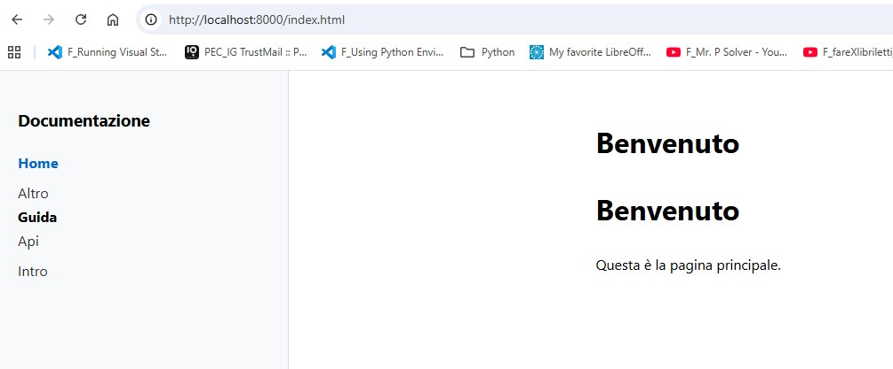

## Docs Site Generator

A minimal static site generator (Markdown → HTML) for project documentation.

### Usage

cd docs-site
python3 -m venv venv && source venv/bin/activate
pip install markdown jinja2
python3 build.py
cd site && python3 -m http.server 8000

