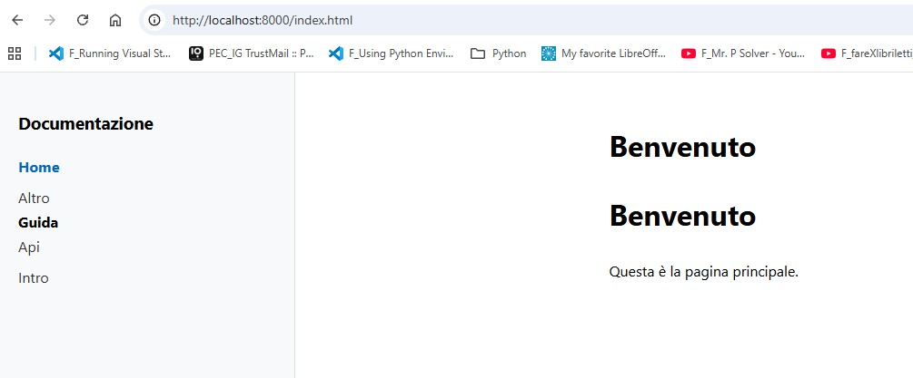

# Office-automation-markitdown and DOC_SITE

# Python document intake with MarkItDown

Mini progetto Python per convertire documenti d'ufficio in Markdown strutturato, utile per automazione documentale, ricerca testuale e pipeline LLM.

Questo repository mostra un caso d'uso semplice ma credibile: leggere file da una cartella `input/`, convertirli in Markdown con MarkItDown e salvare il risultato in `output/`.

## MarkItDown

MarkItDown è un tool open source di Microsoft pensato per convertire file e documenti Office in Markdown, con un uso naturale in classificazione documentale, ingestion per LLM e back-office automation.[1][2]

## Struttura del progetto

markitdown-example/
├── README.md
├── src/
│   └── app.py
├── input/
└── output/

## Installazione

pip install markitdown

## Esempio di output

- `input/delibera.docx`
- `output/delibera.md`

Idee su come estendere il progetto:

- classificazione automatica dei documenti;
- tagging per ufficio o procedimento;
- invio del testo convertito a una pipeline RAG;
- controlli su naming, metadati o qualità documentale.

############## Docs Site Generator

A minimal static site generator (Markdown → HTML) for project documentation.

### Usage

cd docs-site
python3 -m venv venv && source venv/bin/activate
pip install markdown jinja2
python3 build.py
cd site && python3 -m http.server 8000

